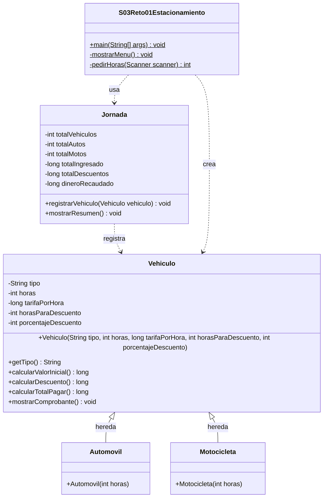

# Reto 1 · Sistema de tarifas de estacionamiento (POO)

Programa de consola en Java que calcula cuánto paga cada vehículo de un parqueadero y muestra el resumen del día.

- **Clase principal:** `S03Reto01Estacionamiento`
- **Entrada:** números enteros leídos con `Scanner`
- **Restricciones:** sin arrays, colecciones ni frameworks; los importes se guardan en `long`

## Cómo ejecutarlo

```bash
cd src
javac *.java
java S03Reto01Estacionamiento
```

## ¿Qué hace el programa?

1. Muestra un menú: `1` Automóvil, `2` Motocicleta, `0` Terminar jornada.
2. Si se elige un vehículo, pide las horas de permanencia (entero mayor a 0).
3. Calcula el valor inicial, el descuento y el total, y muestra el **comprobante**.
4. Cuando se elige `0`, muestra el **resumen final** de la jornada.

## Reglas del negocio

| Vehículo | Tarifa por hora | Descuento |
| --- | --- | --- |
| Automóvil | 4000 pesos | 10 % si permanece **más de 5 horas** |
| Motocicleta | 2000 pesos | 5 % si permanece **más de 8 horas** |

- Con exactamente 5 u 8 horas **no** hay descuento.
- Valor inicial = tarifa × horas.
- Total a pagar = valor inicial − descuento.

## Estructura del proyecto

```
src/
├── Vehiculo.java                  → clase PADRE: lo que tienen en común todos los vehículos
├── Automovil.java                 → clase HIJA: sus números (4000, 5 horas, 10 %)
├── Motocicleta.java               → clase HIJA: sus números (2000, 8 horas, 5 %)
├── Jornada.java                   → la "libreta" del día: contadores y dinero
└── S03Reto01Estacionamiento.java  → menú y lectura de datos (main)
```

| Clase | Qué hace |
| --- | --- |
| `Vehiculo` | Guarda tipo, horas, tarifa y regla de descuento. Calcula valor inicial, descuento, total y muestra el comprobante. |
| `Automovil` | Hereda de `Vehiculo` y solo entrega los datos del automóvil con `super(...)`. |
| `Motocicleta` | Hereda de `Vehiculo` y solo entrega los datos de la motocicleta con `super(...)`. |
| `Jornada` | Cuenta vehículos, autos y motos, y suma ingresado, descuentos y recaudado. |
| `S03Reto01Estacionamiento` | Habla con el usuario: muestra el menú, pide datos y crea los objetos. |

## Diagrama UML

> GitHub muestra este diagrama automáticamente (está escrito en Mermaid).



**Cómo leer el diagrama:**

- El signo `-` significa **private** (solo se usa dentro de la clase) y el `+` significa **public** (se puede usar desde afuera).
- La flecha con triángulo vacío (`<|--`) es **herencia**: `Automovil` y `Motocicleta` *son un* `Vehiculo`.
- La flecha punteada (`..>`) significa **"usa"**: `Jornada` usa vehículos y el `main` usa la jornada y crea los vehículos.
- El `$` marca los métodos `static`.

## Conceptos de POO que se usan

| Concepto | Qué es | Dónde se ve |
| --- | --- | --- |
| **Clase** | Un molde para fabricar objetos | `Vehiculo`, `Jornada`... |
| **Objeto** | Algo real fabricado con el molde (`new`) | `new Automovil(6)` |
| **Atributos** | Los datos que guarda el objeto | `horas`, `tarifaPorHora`... |
| **Métodos** | Lo que el objeto sabe hacer | `calcularTotalPagar()` |
| **Constructor** | Método que se ejecuta con `new` y guarda los datos iniciales | `public Vehiculo(...)` |
| **Encapsulamiento** | Atributos `private` y, si hay que leerlos, un *getter* | `getTipo()` |
| **Herencia** | La hija recibe todo el código del padre con `extends` | `Automovil extends Vehiculo` |
| **`super(...)`** | La hija le entrega sus datos al constructor del padre | `super("Automóvil", horas, 4000, 5, 10)` |
| **Polimorfismo (fácil)** | Una variable `Vehiculo` puede guardar un auto o una moto | `Vehiculo vehiculo = new Automovil(horas);` |

Gracias a la herencia, el código de los cálculos se escribe **una sola vez** en `Vehiculo`. Las hijas solo cambian los números.

## Cómo funciona el flujo

```
main muestra el menú
      │
      ▼
usuario elige 1 o 2 ──► main pide las horas ──► main crea new Automovil(horas) o new Motocicleta(horas)
                                                         │
                                                         ▼
                                       vehiculo.mostrarComprobante()
                                                         │
                                                         ▼
                                       jornada.registrarVehiculo(vehiculo)
      ▲                                                  │
      └──────────────────────────────────────────────────┘
usuario elige 0 ──► jornada.mostrarResumen() ──► fin
```

## Decisiones de diseño

- **Importes en `long`:** las tarifas son múltiplos de 100, así que `valorInicial * 10 / 100` y `valorInicial * 5 / 100` siempre dan pesos enteros y no hace falta `double`.
- **Validación de entradas:** se usa `hasNextInt()` para saber si lo escrito es un entero; si no lo es, se muestra el error, se descarta con `next()` y se vuelve a pedir.
- **Horas inválidas:** si las horas son un texto o son menores o iguales a 0, se vuelve a pedir **solo las horas**, sin regresar al menú.
- **Se registra al final:** el vehículo se agrega a la jornada solo cuando ya tiene tipo y horas válidos.
- **Cuentas coherentes:** siempre se cumple `totalIngresado − totalDescuentos = dineroRecaudado`.

## Pruebas

| Vehículo | Entrada (opción, horas) | Valor inicial | Descuento | Total |
| --- | --- | --- | --- | --- |
| Automóvil | 1, 5 | 20000 | 0 | 20000 |
| Automóvil | 1, 6 | 24000 | 2400 | 21600 |
| Motocicleta | 2, 8 | 16000 | 0 | 16000 |
| Motocicleta | 2, 9 | 18000 | 900 | 17100 |

**Jornada con los cuatro vehículos** (entradas: `1 5 1 6 2 8 2 9 0`):

```
Vehículos totales registrados: 4
Automóviles registrados: 2
Motocicletas registradas: 2
Total ingresado: 78000 pesos
Total de descuentos: 3300 pesos
Total recaudado: 74700 pesos
```

**Datos inválidos** (entradas: `7`, `1`, `0`, `-3`, `2`, `4`, `0`):

- Opción `7` → `Error: Opción no válida. Por favor, elija 1, 2 o 0.`
- Opción `1` con horas `0` y luego `-3` → error y se vuelven a pedir las horas.
- Horas `2` → se registra el automóvil (8000 pesos, sin descuento).
- Opción `4` → error de opción no válida; luego `0` termina la jornada.
- Resumen final: 1 vehículo, 1 automóvil, 0 motocicletas y 8000 pesos recaudados.

**Terminar de inmediato** (entrada: `0`) → todos los contadores y totales quedan en 0.

## Cómo agregar un nuevo tipo de vehículo (por ejemplo, Camión)

1. Crear `Camion.java` copiando `Motocicleta.java` y cambiando `extends Vehiculo` y los números del `super(...)`.
2. Agregar la opción `3` al menú y un `new Camion(horas)` en el `main`.
3. (Opcional) Agregar un contador de camiones en `Jornada` si se quiere ver en el resumen.

`Vehiculo` no se modifica.